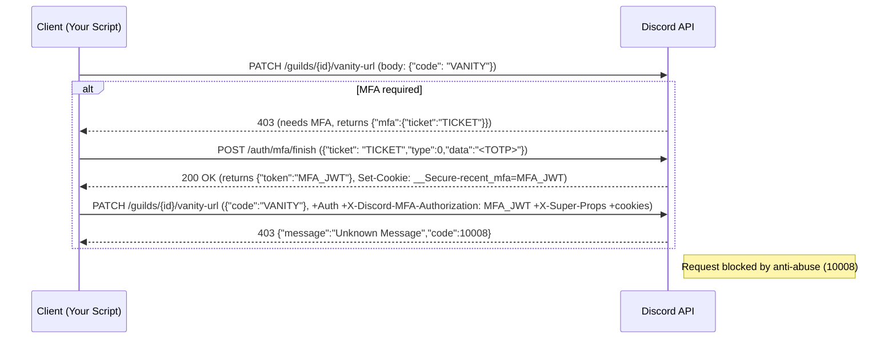

# Vanity Sniper 10008 Error Analysis

**Executive Summary:** Discord error code **10008 (Unknown Message)** typically means “resource not found,” but in a 403 Forbidden context it often signals that Discord’s anti-abuse systems have blocked the request. In the case of vanity URL claim flows, this can happen if any part of the request fails the multi-factor or session validation. We examine each step of the vanity URL *lock/claim* process. Discord’s official docs list a GET `/guilds/{id}/vanity-url` (requiring `MANAGE_GUILD` permission) to view the code, and an analogous PATCH (undocumented) to set it. Recent changes require a full MFA handshake. In practice, the flow is: 1) **PATCH** to `/guilds/:id/vanity-url` with the new code; 2) if MFA is enabled, Discord responds with a ticket; 3) client calls `POST /auth/mfa/finish` with the ticket and TOTP to get a short-lived JWT; 4) client retries the PATCH with the JWT (and relevant cookies/headers). A 403+10008 at the final step indicates Discord is rejecting the request as suspicious (often *anti-abuse*).  

From community reports, Discord *now requires 2FA* to change a vanity URL. For example, a recent GitHub issue notes “**two factor authentication for changing the vanity URL now, needs to be integrated**”. This aligns with the MFA flow described below. 

To troubleshoot: capture and log **all request details** – endpoint URL, method, headers (including cookies, CSRF tokens, Origin/Referer if any, `Authorization`, `X-Discord-MFA-Authorization`, `X-Super-Properties`, etc.), and JSON body – as well as the full response (HTTP status, JSON error, and headers such as `X-RateLimit-*` or `Set-Cookie`). Compare this against a normal web client (browser) or Discord official client’s behavior. Use tools or proxy to replay requests exactly (including cookies) and experiment with adding/removing headers or delays. 

Below we analyze each aspect, then summarize in a checklist and comparison table.

## 10008 “Unknown Message” in Discord’s API

Discord’s [official JSON error codes](https://discord.com/developers/docs/topics/opcodes-and-status-codes#json) define **10008** as **“Unknown Message”**. Normally this means the specified message ID doesn’t exist or isn’t visible to you. However, Discord also uses this code generically: in particular, if a request is **blocked by anti-abuse systems**, it often returns HTTP 403 with `{"message":"Unknown Message","code":10008}`. In other words, the 10008 here is a *generic mask* for “we won’t tell you why,” often due to suspicious or forbidden actions. 

> **Example (community docs):** A 403 response with `code=10008` “indicates your request has been blocked by Discord’s anti abuse systems, despite the error message being ‘Unknown Message’”.  

In our context, every **PATCH** to claim the vanity URL yields 403+10008. That suggests Discord isn’t finding a required message or step, or is flagging the request. Possible interpretations: wrong endpoint/method, stale or missing MFA ticket, missing CSRF or cookies, or anti-bot triggers (e.g. missing client headers, rapid requests).  

## Vanity URL Claim Flow and MFA

A typical *vanity URL lock/claim* flow is:  

1. **Prepare MFA (if enabled):** If the account has 2FA, Discord will require proving it for sensitive actions. Attempting the PATCH without MFA should yield a 403 response containing an MFA ticket. 
2. **Get MFA Token:** Call `POST /auth/mfa/finish` with JSON `{"ticket": "...", "type": 0, "code": "xxxxxx"}` (type 0 = TOTP). Discord returns a short-lived JWT (`token` in JSON) and sets a cookie `__Secure-recent_mfa`. This JWT (expiration ~5 minutes) proves the TOTP challenge was solved.  
3. **Retry Claim:** Retry the PATCH `/guilds/{guild_id}/vanity-url` with the **same JSON body** (`{"code": "<vanity>"}`) and include the new MFA credential: either an `X-Discord-MFA-Authorization: <token>` header or the cookie. The request must also include normal Auth (user token) and all required headers/cookies to mimic a real client. 

If any of these steps fails (e.g. wrong ticket, expired token, missing headers/cookies), Discord will reject the PATCH. Notably, an out-of-sync MFA or missing `X-Discord-MFA-Authorization` can cause the server to interpret it as unauthorized or invalid.  

**Key endpoints:**  
- `PATCH /guilds/{guild_id}/vanity-url` with JSON `{"code": "newCode"}` – changes the vanity code (requires MANAGE_GUILD and MFA).  
- `POST /auth/mfa/finish` with JSON `{"ticket": "<ticket>", "type": 0, "data": "<TOTP>"}` – finishes MFA, returns `{ "token": "<JWT>" }`.  

These are *undocumented* in Discord’s official public docs, but confirmed by community reverse-engineering (e.g. [23] and [61]). For example, [61] reports “**discord now needs 2FA codes for changing vanities**”. 

### MFA Handling Details

When Discord replies with a JSON like `{"mfa":{"ticket":"<ticket_id>"}}`, you must take that ticket to `/auth/mfa/finish`. The Discord userdocs note: “the verification JWT can then be inserted into the `X-Discord-MFA-Authorization` header and the original request can be retried”. After verifying, Discord sets a `__Secure-recent_mfa` cookie (valid 5 min) to skip MFA for a short time. 

Thus, to implement this: 
- Perform the PATCH once, catch the 403 MFA response and extract `mfa.ticket`.
- Call `POST /auth/mfa/finish` with your TOTP (usually the user’s authenticator code). 
- Store the returned `token` (and ensure the `__Secure-recent_mfa` cookie is preserved).
- Add header `X-Discord-MFA-Authorization: <token>` to the next PATCH (or ensure the cookie is sent). 
- Then call PATCH again.

If this is done correctly and timely, Discord should accept the new vanity (response 200 or 204). If you skip adding the token header or cookie, Discord will treat the request as missing credentials and may respond with 403. Often Discord conceals details, returning 10008.

## Request Validation: Headers, Cookies, Tokens

Discord’s **APIs expect requests to look like a real client session.** Key requirements include:

- **Authorization:** The `Authorization: Bot <token>` (for bots) or `Authorization: <user_token>` (for user tokens) header must be correct. Vanity URLs can only be managed by user accounts (bots cannot claim server vanity URLs), so a user token with the right guild permissions is needed. (Discord explicitly forbids *self-bots*, so be aware this violates policy; see Safe Testing below.)

- **MFA Header or Cookie:** As noted, after MFA, include the header `X-Discord-MFA-Authorization: <JWT>` and/or ensure the `__Secure-recent_mfa` cookie is sent. The community-auth documentation confirms the use of `X-Discord-MFA-Authorization` for elevated requests.

- **X-Super-Properties:** Although not mandatory, **Discord strongly expects** the `X-Super-Properties` header on requests, especially for user accounts. This header is a Base64 JSON blob describing your client properties (OS, browser, client build, etc.). The docs warn that missing or incorrect values here can trigger anti-abuse blocks. As they state: *“including this header is highly recommended due to its significance in anti-abuse systems”*. In practice, many self-bot tools omit it and get banned; setting it (consistent with your User-Agent) often fixes mysterious 10008 blocks.

- **User-Agent:** Similarly, use a realistic User-Agent (e.g. the official Discord Windows/macOS client or a common browser string). Discord’s docs say bots must use `DiscordBot` in UA, and other clients should match their platform. At minimum, use a UA string consistent with the X-Super-Properties. 

- **Accept Headers and Locales:** Include `Accept: application/json` (or `*/*`), and a language header like `Accept-Language: en-US`. Also include `X-Discord-Locale` or `locale` cookie if mimicking a web client. In some examples, Discord clients send `Accept-Language`.

- **Content-Type:** For PATCHing JSON, send `Content-Type: application/json`. 

- **Origin/Referer:** If your client uses CORS (e.g. a browser), include `Origin: https://discord.com` and a relevant `Referer`. In our registration code example, the `Referer` is `https://discord.com/register`. For a vanity change from the server settings page, `Referer` might be the guild settings URL. If you’re not using CORS (just an HTTP library), these may not be required, but adding them makes the request look more legitimate.

- **X-Context-Properties (optional):** The example registration flow also uses `X-Context-Properties` (Base64 JSON indicating the action location, e.g. `{"location":"Register"}`). For vanity changes, Discord might look for something like `{"location":"GuildSettings"}`. This header isn’t documented, but some reverse-engineered clients include it. It may not be strictly required, but including it (with your guild ID as referrer, e.g. `{"location":"GuildSettings","referrer":<guildID>}`) can help.

- **Cookies:** Maintain a session cookie jar. Discord sets cookies like `__dcfduid` and `__sdcfduid` and login cookies. Critically after MFA, the `__Secure-recent_mfa` cookie should be present. If your HTTP client doesn’t automatically handle cookies, capture and resend them. Losing the session cookies or fresh login tokens between requests can cause 403.

- **CSRF Token:** For user accounts, Discord APIs use authorization tokens instead of CSRF tokens. There is *no* separate CSRF header needed once authenticated by token. (CSRF is only relevant in web forms, not token-based API calls.)

In summary, ensure your request mirrors the browser: correct `Authorization`, MFA token, `User-Agent`, `X-Super-Properties`, `X-Context-Properties`, `Accept-Language`, referer/origin, and cookies.

## Rate Limits and Anti-Abuse

Discord enforces **rate limits** on all endpoints. Exceeding a rate limit yields HTTP **429 Too Many Requests**, not 403. A 429 response will include JSON with `"retry_after"` and rate-limit headers. If you get a 429, back off for the specified time. Always monitor `X-RateLimit-Remaining` and respect the `Retry-After` header. Failing to rate-limit can get your token suspended. 

However, **error 10008 (403)** is usually *not* a simple rate-limit issue but an abuse detection. Discord’s system can rate-limit or outright block accounts that it deems suspicious or automated. For example, rapidly replaying HTTP requests without a real client fingerprint can trigger this. The Discord documentation on anti-abuse is not public, but community docs note specifically that 10008 often hides an abuse block. 

Other triggers for anti-abuse blocks:
- **Unusual IPs or proxies:** Using unfamiliar or blacklisted proxies can cause Discord to block calls with 10008.
- **Bots/self-bots:** Discord’s policy forbids automating user accounts. If it detects a user token making high-frequency API calls (especially vanity or invite sniping), it will block or ban the account. Many self-bot programs get quickly banned. Always test with care (see Safe Testing below).
- **Missing client hints:** As noted, omitting `X-Super-Properties` or a realistic UA may be treated as spammy.
- **Global limits:** Each user account globally can only make ~50 requests/second. Surpassing this even legally (through multiple routes) triggers a temporary ban (HTTP 429 then possibly 403). 

In short, a **403+10008** almost always means Discord stopped you due to perceived platform manipulation. The user in [39] notes *“your request has been blocked by Discord’s anti abuse systems”*.

## Reproducing and Diagnostics

To reliably reproduce and diagnose the error, follow these steps:

1. **Enable Detailed Logging:** Capture raw request and response data. For example, use `curl -v` or an HTTP proxy (like mitmproxy or Fiddler) while running your code. Log: 
   - **Request**: Method, URL, all headers, JSON body.  
   - **Response**: HTTP status, JSON body, all headers (especially `X-RateLimit-*` and any `Set-Cookie`).  
   - **Cookies**: Show cookies before and after MFA to ensure `__Secure-recent_mfa` is set.

2. **Compare with Browser:** Manually perform the action in a web browser (or the official Discord client, if possible) while in Developer Tools. Find the network call for claiming/locking the vanity URL and note the exact payload, headers, and cookies the client sends. The browser flow should show the same PATCH and MFA calls; replicate those headers exactly in your script.

3. **Test Without MFA:** Try calling the PATCH **without** adding the `X-Discord-MFA-Authorization` header (or cookie) to see if you get a different error (e.g. another 403 with an MFA ticket). Then perform the MFA step and retry.

4. **Toggle Headers/Cookies:** Systematically omit or alter headers/cookies in test requests to see which one triggers the 10008. For example:
   - Remove `X-Super-Properties`: does it fix or break?
   - Change `User-Agent`.
   - Remove or modify `Referer`/`Origin`.
   - Send/omit `X-Context-Properties`.
   - Use or drop `X-Discord-Locale`.

5. **Timing:** Discord’s anti-abuse may be sensitive to timing. Try adding a small delay between the MFA step and the PATCH, or making the PATCH immediately after obtaining the JWT. The MFA token is only valid for 5 minutes, so retry within that window. Also ensure the system time is correct and the TOTP code is fresh.

6. **Rate-limit Testing:** Monitor the `X-RateLimit-Remaining` headers when you run the script. If it hits 0, you’ll see a 429. If not, ensure you’re not accidentally hitting a *global* limit by having other processes. 

7. **Try a Clean Session:** Log in from scratch. In some cases, cookies from a stale or partial login might cause 403. Ensure your script logs in (or uses a valid token and its cookies) just before claiming. If possible, open a fresh browser session to see if the token still has the session intact.

8. **Alternate Environment:** If you normally run in one location or network, try running from a different IP or network. If the IP was flagged, a different IP might work.

By varying one factor at a time and logging the result, you can pinpoint why Discord rejected the request.

## Fixes and Mitigations (with Code Examples)

Based on the likely causes above, the following mitigations should be applied:

- **Include X-Super-Properties and Valid UA:** Add a header like:  
  ```js
  // Node.js example using fetch or axios
  const clientProps = {
    os: "Windows", browser: "Chrome", device: "",
    browser_user_agent: "Mozilla/5.0 (Windows NT 10.0; Win64; x64)...",
    browser_version: "90.0.4430.212", client_build_number: 927030
    // (Fill in appropriate values, or copy from the official client’s values)
  };
  headers["X-Super-Properties"] = Buffer.from(JSON.stringify(clientProps)).toString("base64");
  headers["User-Agent"] = clientProps.browser_user_agent;
  ```  
  In Python with `requests`, similarly do:  
  ```python
  import base64, json, requests
  client_props = {
    "os": "Windows", "browser": "Chrome", "device": "",
    "browser_user_agent": "Mozilla/5.0 (Windows NT 10.0; Win64; x64)...",
    "browser_version": "90.0.4430.212", "client_build_number": 927030
  }
  headers = {
    "User-Agent": client_props["browser_user_agent"],
    "X-Super-Properties": base64.b64encode(json.dumps(client_props).encode()).decode(),
    "Authorization": user_token,
    "Content-Type": "application/json"
  }
  ```

- **Proper MFA Handshake:** After receiving the MFA ticket (from the first PATCH attempt), call:  
  ```js
  // Node.js: verify MFA
  const mfaResponse = await fetch("https://discord.com/api/v10/auth/mfa/finish", {
    method: "POST",
    headers: { ...headers },
    body: JSON.stringify({ ticket: mfaTicket, type: 0, code: totpCode })
  });
  const mfaJson = await mfaResponse.json();
  const mfaToken = mfaJson.token;  // the JWT
  // Use this in next request:
  headers["X-Discord-MFA-Authorization"] = mfaToken;
  ```  
  ```python
  # Python: verify MFA
  data = {"ticket": mfa_ticket, "type": 0, "data": totp_code}
  verify = requests.post("https://discord.com/api/v10/auth/mfa/finish", headers=headers, json=data)
  jwt = verify.json().get("token")
  headers["X-Discord-MFA-Authorization"] = jwt
  session = requests.Session()
  session.cookies.set("__Secure-recent_mfa", jwt, domain="discord.com")
  ```

  Then **retry the PATCH**:  
  ```js
  const patchRes = await fetch(`https://discord.com/api/v10/guilds/${guildId}/vanity-url`, {
    method: "PATCH",
    headers: headers,
    body: JSON.stringify({ code: desiredVanityCode })
  });
  console.log(await patchRes.text());
  ```  
  ```python
  res = session.patch(f"https://discord.com/api/v10/guilds/{guild_id}/vanity-url",
                      headers=headers, json={"code": desired_vanity})
  print(res.status_code, res.text)
  ```

- **Manage Cookies and Session:** Use a single HTTP session to carry cookies through the flow. In Node you may use a library that preserves cookies (or manually parse `Set-Cookie`). In Python, `requests.Session()` handles cookies automatically. After the MFA verify, ensure the `__Secure-recent_mfa` cookie is present in the session. This cookie might allow subsequent calls without needing the header (but include the header anyway).

- **Rate-Limit Backoff:** If a request returns HTTP 429 or a 403 that might be global-limit related, implement an exponential backoff (e.g., wait 2s, 5s, 10s, etc., then retry). Use the `Retry-After` header from 429 to pause exactly. Typically, don’t hammer the endpoint; a short delay (500ms–1s) between retries can avoid triggering abuse blocks.

- **Timing and Retries:** If you still get 10008 after adding headers, try repeating the request one more time (sometimes the first MFA-backed PATCH may succeed unexpectedly, or a retry after a second might catch the cookie state). However, avoid spamming – use a backoff if it keeps failing.

- **Logging:** Log all HTTP transactions. For example: 
  ```js
  console.log("PATCH request headers:", headers, "body:", JSON.stringify({code: desiredVanity}));
  console.log("Response:", patchRes.status, await patchRes.json());
  ```
  In Python: 
  ```python
  print("Headers:", headers, "Body:", {"code": desired_vanity})
  print("Status:", res.status_code, "Response:", res.json())
  ```
  Examine these logs to confirm every required value is correctly sent.

- **Use Minimal Permissions:** Ensure the token has `MANAGE_GUILD`. If the guild is a *partner* or *verified*, the user must be the server owner or have the special permission. If using an OAuth token, it should have the correct scope (though user tokens generally suffice).

## Troubleshooting Checklist and Diagnostics Table

| Possible Cause                         | Diagnostic Test                             | Expected Result                              | Fix/Mitigation                               |
|----------------------------------------|---------------------------------------------|----------------------------------------------|---------------------------------------------|
| **Missing/Expired MFA token**          | Did PATCH return an MFA ticket? Try sending PATCH without `X-Discord-MFA-Authorization` header. | If MFA required, you’ll get a 403 JSON with `{"mfa":{"ticket":...}}`. Otherwise, if no MFA prompt, check account settings. | Ensure to do `/auth/mfa/finish` and get JWT. Use `X-Discord-MFA-Authorization` header on second attempt (or cookie).|
| **No `__Secure-recent_mfa` cookie**    | After verifying MFA, check session cookies. Is `__Secure-recent_mfa` set? | The cookie should be set by the response to `/auth/mfa/finish`. | If missing, manually set the cookie in your session equal to the returned JWT value. |
| **Incorrect Headers (X-Super-Properties)** | Omit `X-Super-Properties` and retry (expect still failing) vs add a well-formed one. | Without it, Discord likely blocks. With correct `X-Super-Properties`, request may succeed or give a different error. | Always include a valid `X-Super-Properties` matching your client info. |
| **Incorrect User-Agent**              | Use a generic UA or DiscordClient UA. Check if error persists. | Using a realistic UA may avoid anti-bot detection. | Match the User-Agent to the X-Super-Properties info. |
| **Missing X-Context-Properties** (if needed) | Compare with browser: does the browser send a context header? If so, emulate it. | Without it, some actions may be blocked. | Set e.g. `"X-Context-Properties": Base64('{"location":"GuildSettings","referrer":guildId}')`. |
| **Rate-limited / Cloudflare ban**     | Check for HTTP 429 or 403 code 40333 (internal network error). Inspect `X-RateLimit-*` headers. | 429 means you’re rate-limited; 40333 means Cloudflare blocked. | Respect rate limits: implement backoff using `Retry-After`. Slow down requests. |
| **Session out-of-sync / Bad cookies** | Use a fresh login/token or a new Session object. Re-run from scratch. | If old cookies were invalid, a fresh session may succeed. | Always carry cookies from login to claim. If uncertain, re-login and re-MFA each run. |
| **Vanity is already claimed or locked** | Confirm the target vanity code is actually available. Does `GET /guilds/{id}/vanity-url` show it? | If vanity is unavailable or already locked, patch will fail or be ignored. | Only attempt to claim truly available vanities. Check guild’s boost status (must be Level 3) and that you are allowed. |
| **Platform Manipulation / Policy**     | Consider that Discord bans self-bots (no API for user accounts). | Discord may permanently block accounts that violate policy. | For safe testing, only use small-scale manual or controlled bots. Avoid any behavior that could be seen as spam or abuse. |

Use this checklist when a 403+10008 occurs. At each step, *log all request and response details*. For example, if X-Super-Properties was missing, logs would show a 403:10008 without obvious cause – try adding it and see if the error changes or goes away.

## Safe Testing and Compliance

**Important:** Automating a user account (*self-bot*) to claim vanity URLs violates Discord’s policies and can lead to account suspension. For “safe tests,” use *test servers* and *test accounts* (with permission) in a controlled manner. Do not mass-snipe across many servers. Always include respectful delays (≤ 1 req/s) and monitor for any warning headers. Do not share or sell the code, and do not use proxies in a way that could be blacklisted by Discord. In other words, avoid triggering the very protections we’re analyzing.

The Discord Community Guidelines explicitly state: *“Do not use self-bots or user-bots. Each account must be associated with a human, not a bot.”*. Any automated vanity sniping can be considered “Platform Manipulation” (spam/abuse), for which Discord may ban accounts. 

## Mermaid Sequence Diagram



This diagram shows the *claim* flow. The second PATCH (with the MFA token) is where the 10008 error occurs in practice. By tracing this flow and carefully inspecting each request/response (with the techniques above), you can identify which element is causing Discord to reject the request.

**Sources:** Official Discord docs on error codes and rate limits, community reverse-engineering of MFA and vanity endpoints, and policy docs. These clarify the required headers, MFA process, and anti-abuse signals involved. The suggested fixes (adding headers/cookies, retries, logging) are drawn from this documentation and common developer experiences.